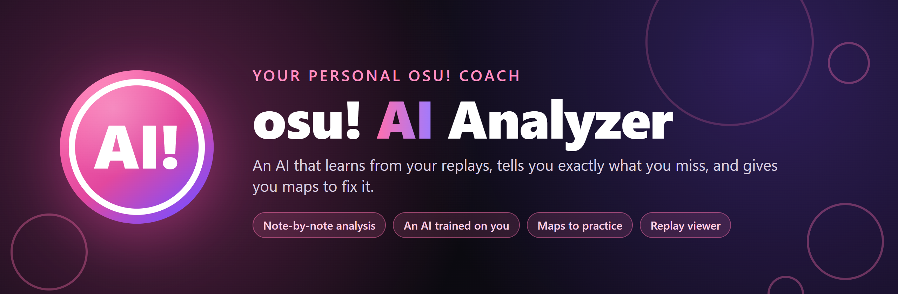
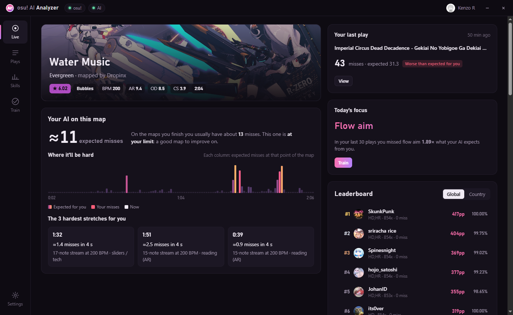
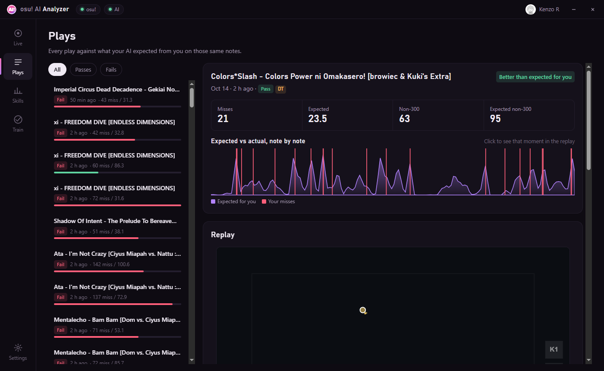
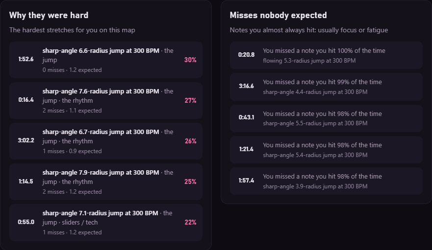
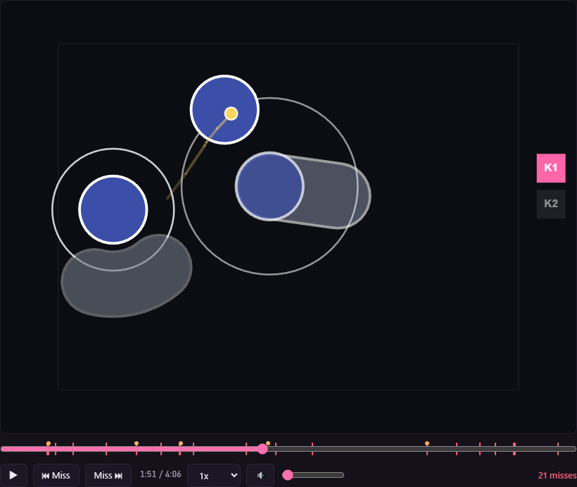
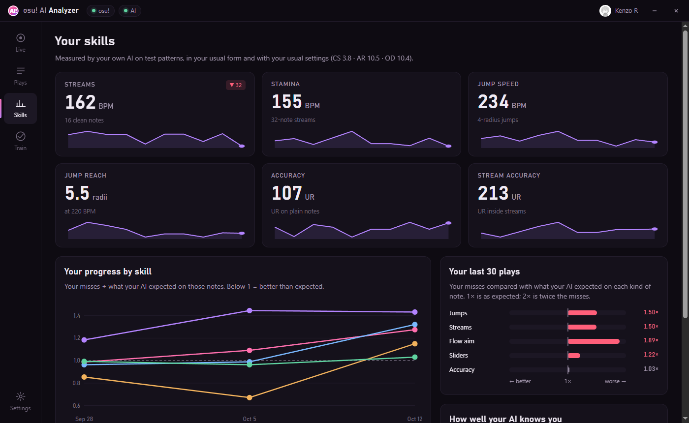
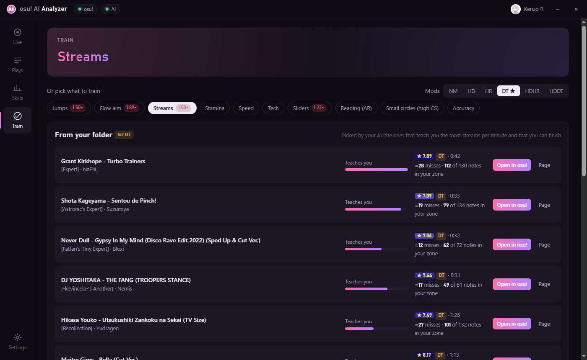
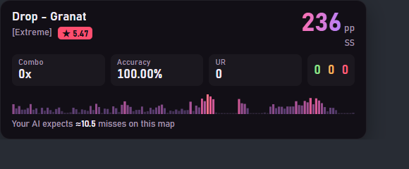
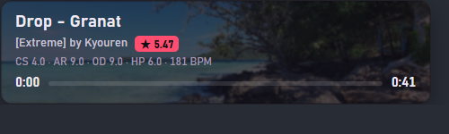
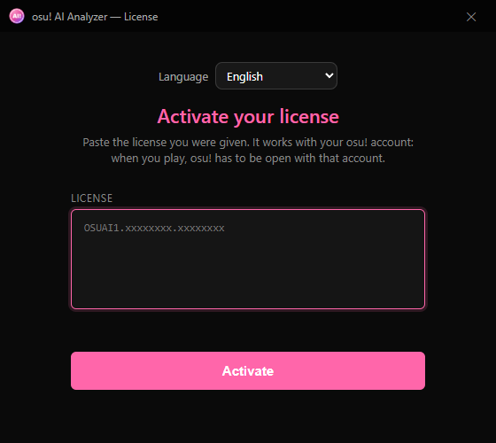

  

  
  
  
  

  <a href="README.md">Español</a> · <b>English</b>

---

**osu! AI Analyzer** is a Windows app that runs alongside osu! stable. It has a neural network that learns **only from your own plays**, note by note, and uses it for three things:

- **Before you play a map:** how many misses it expects from you, at which seconds, and which pattern will cause them.
- **After you play it:** where you missed more or less than expected, and which misses came from the map and which from focus or fatigue.
- **For practice:** which skill you should train and which maps from your own folder teach you that skill the most.

  

## Contents

- [What it does](#what-it-does)
- [How it works](#how-it-works)
- [Performance](#performance)
- [Privacy and license](#privacy-and-license)
- [Install](#install)
- [FAQ](#faq)

## What it does

### Live: your AI before you play

When you select a map in osu!, the **Live** screen shows:

- **Expected misses** for you on that map, compared with what you usually get on maps you finish. It tells you whether the map is comfortable, at your limit, or well above your level.
- **Where it'll be hard:** a bar with the expected misses at each moment of the map. While you play, it marks your real misses and where you are.
- **Your 3 hardest stretches**, each with the concrete pattern that makes it hard, for example *"17-note stream at 200 BPM"* or *"5.3-radius jump at 230 BPM"*.
- The global or country **leaderboard**, your last play, and the skill to train today.

### Plays: every attempt against what was expected of you

Every play is kept as a **Pass** (you finished the map) or a **Fail** (you died, quit or retried). For each one:

- **Expected against actual, note by note**, in a chart you can click to jump to that moment of the replay.
- **The replay inside the app**, with the cursor, the keys, the map's audio and the misses marked. Also for fails, even though osu! keeps no replay of them (see [how it works](#how-it-works)).
- **Why they were hard:** your 5 hardest stretches, with their pattern, the misses you had and the ones expected.
- **Misses nobody expected:** misses on notes you almost always hit. They are usually focus or fatigue, not a lack of skill. Misses close together are grouped.
- **Where your clicks land** on jumps (short or past the note) and your timing error.

  

  
  

### Skills: measured by your own AI

Your AI plays test patterns (16-note streams, 32-note streams, 4-radius jumps at different BPMs, longer and longer jumps at 220 BPM) with your usual settings (CS, AR, OD) and finds where your limit is. That gives you:

| Skill | What it measures |
|---|---|
| Streams | BPM at which you clear 16 notes in a row |
| Stamina | BPM at which you hold 32-note streams |
| Jump speed | BPM at which you hit 4-radius jumps |
| Jump reach | longest jump you hit at 220 BPM |
| Accuracy | your UR on plain notes |
| Stream accuracy | your UR inside streams |

You also see your progress per skill over time and, over your last 30 plays, how many misses you had on each kind of note compared with what your AI expected (1× is as expected; 2× is twice as many).

  

### Train: what to practice and with which maps

The app suggests the skill that's costing you the most, or you pick one of ten: jumps, flow aim, streams, stamina, speed, tech, sliders, reading (AR), small circles (high CS) and accuracy. For that skill it gives you:

- **Maps from your folder**, 10 per page, for the mods you choose (NM, HD, HR, DT, HDHR, HDDT). A map only shows up for a skillset if that pattern is what the map is mostly made of: *Streams* lists stream maps, not jump maps with a few streams. They are ranked by how much they teach you about that skill per minute, and only maps you can finish make the list. One click opens it in osu!.
- **A map made for you** (an `.osz` file), with the pattern of that skill that's hardest for you and the difficulty rising in 6 stretches up to your limit.
- **Is it working?:** compares your plays before and after you started practicing a skill, always against what was expected of you.

  

### Stream overlays

The app adds its own overlays to the tosu dashboard, each with its own link to use as a *Browser source* in OBS: map and time, PP, keys, 100/50/miss, combo and accuracy, a hit error bar with UR, what your AI expects on the map, and a full one with everything.

  
  

### Also

- **13 languages:** Spanish, English, Portuguese, French, German, Russian, Polish, Turkish, Indonesian, Japanese, Korean and Chinese (simplified and traditional). The app starts in the language of Windows, and you can change it from the very first window.
- **Automatic updates:** when a new version is out, the app offers it and installs it by itself. Every update is signed, and the app refuses any file that isn't.

## How it works

### 1. It reads the game without changing it

The app doesn't touch osu!. It reads what happens in the game through [tosu](https://github.com/tosuapp/tosu), the same reader stream overlays use: the selected map, the mods, health, hits and keys. Finished plays come from the replays osu! already saves in your folder (`Data/r`).

### 2. It judges every note

With the map (`.osu`) and the replay, the app judges the play again note by note, the way osu! does: 300, 100, 50 or miss, your timing error in milliseconds, and where your click landed relative to the center of the note.

osu! keeps no replay of a fail or of a map you leave halfway. For those, the app records your cursor and keys while you play, then rebuilds the play and judges it the same way. It keeps it only if it matches what osu! counted; otherwise it throws it away.

### 3. It describes every note with numbers

Each note gets 27 measurements from the map: jump distance and angle, speed, time since the previous note, BPM, whether it's in a stream and where, whether it's a slider, AR, CS, OD, how far into the map it is, how many minutes you've been playing, and more. On top of that come 4 facts about how you start the play: how many times you've already tried the map, how long since your previous play, how many plays into the session you are, and how your last 5 went.

### 4. The neural network

Each note is looked at together with the 12 before it and the 4 after it, because a jump is harder when it comes at the end of a stream. That 17-note window goes into a two-layer network (256 and 128 neurons) that predicts, for every note:

- the chance of a miss,
- the chance of not getting a 300,
- your expected timing error and how much it varies,
- where your click drifts, along the jump and to the sides.

There are 3 networks trained separately, and the app uses the average of the three, which is steadier than a single one.

### 5. It trains on your PC, only with your plays

- The first time, it reads every replay you have and trains. With about 200 plays it takes around a minute.
- After that it retrains by itself once you have 10% more plays than last time.
- Before it's used, it's tested on your most recent plays, which it never sees while training. If it doesn't predict better than your averages, the app doesn't use it.
- All of that stays on your PC.

### 6. What is worked out with the network

- **A map's forecast:** the network predicts every note of a map before you play it. The sum is your expected misses, and the places where they pile up are the hard stretches.
- **Your play against what was expected:** compared with what an AI that hadn't seen that play yet expected, so the comparison is fair.
- **Practice maps:** the network scores every map of your folder near your level (thousands, for each mod combination). For each skill it measures how much new information the map gives you per minute: the notes that teach you the most are the ones you have a middling chance of missing. Then it keeps the maps where that skill is the main pattern and that you can finish.
- **Skills:** the network plays test patterns at different speeds and distances until it finds your limit.

## Performance

The app is built not to take performance away from osu!:

- **While you play a map**, all background work (reading replays, training, scoring the folder) pauses and resumes when you're back in the menus.
- The AI service runs at **low priority** and uses **at most 2 cores**.
- **When idle**, the app uses between 2 and 6% CPU.

Measured on version 2.0.1:

| | Time |
|---|---|
| Switching screens | under 0.1 s |
| Opening a play with its replay | 0.1 to 0.5 s |
| Changing skillset or page in Train | under 0.1 s |
| First start (200 replays: read, train and score the folder) | about 2 minutes |

Simulating a low-end PC (interface 4 times slower and the AI service on 1 core), no action took more than 1 second.

## Privacy and license

- **Your replays, your plays and your AI stay on your PC.** None of it is uploaded anywhere.
- The app only connects to the internet to ask the osu! API for leaderboards and map data, to check your license, and to look for updates.
- **The license is tied to your osu! account.** When you open the app, only the activation window shows up first. The full app opens only once the license is valid, the server confirms it, and osu! is open with that same account.
- Licenses are digitally signed: they can't be made up or edited, and they can be deactivated from the server.
- The application's source code is not public.

  

## Install

> **Closed beta:** the app needs a license tied to your osu! account. If you'd like to try it, message **[Kenzo R on osu!](https://osu.ppy.sh/users/10338561)**.

1. Download **`osu-AI-Analyzer-Setup-x.y.z.exe`** from [**Releases**](https://github.com/justafailure1/osu-ai-analyzer/releases/latest).
2. Run it. Windows may show *"Windows protected your PC"* because the installer isn't signed with a commercial certificate: click **More info**, then **Run anyway**.
3. In the activation window, pick your language and paste your license.
4. Open osu! with the license's account. The app opens by itself; the first time it reads your replays and trains your AI (about 2 minutes).

**Requirements:** Windows 10 or 11 (64-bit), osu! stable and 1 GB of free space.

## FAQ

<b>Does it work with osu!lazer?</b>

It's built for osu! stable. osu!lazer support is being tested.

<b>How long until the AI knows me?</b>

The replays you already have in osu! count from day one. It needs at least 20 plays; with about 200 it trains in a couple of minutes. After that it retrains by itself every time you have 10% more plays.

<b>Why does a retry or quitting a map show as a Fail?</b>

For the app, an attempt that didn't reach the end of the map is a Fail, whether your health ran out, you quit or you retried. It still counts as data for your AI, and you can watch its replay.

<b>Why are there few maps for a skillset?</b>

A map only shows up if it really belongs to that skillset and you can finish it. If your folder has few maps like that near your level (it happens sometimes with stamina or accuracy), the app shows the ones there are instead of filling the list with other kinds of maps. Trying other mods usually gives more options.

<b>Why is my country's leaderboard missing?</b>

osu! only gives country leaderboards to accounts with osu!supporter.

<b>Do I lose my data if I reinstall or update?</b>

No. Uninstalling or updating keeps your plays, your AI, your language and your license.

---

   
  osu! AI Analyzer is not affiliated with osu! or ppy Pty Ltd. · Proprietary software, all rights reserved. 
  It uses third-party components under their own licenses (including tosu and lazer-calculator, LGPL-3.0); details are in the <code>licencias</code> folder of the installation.

