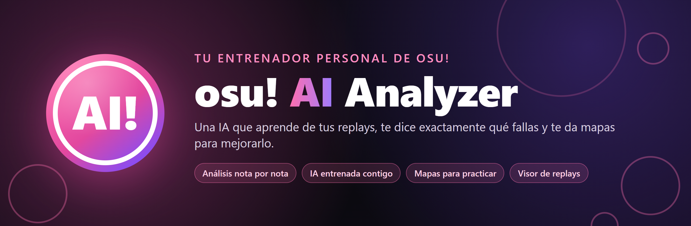
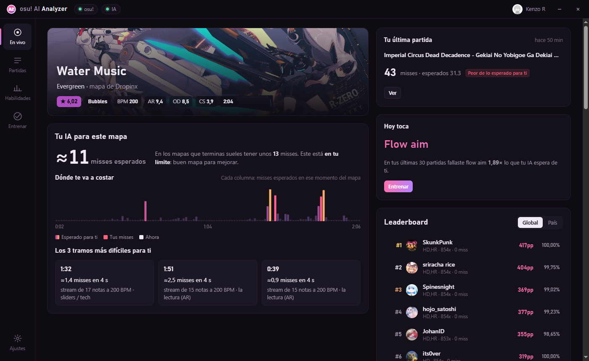
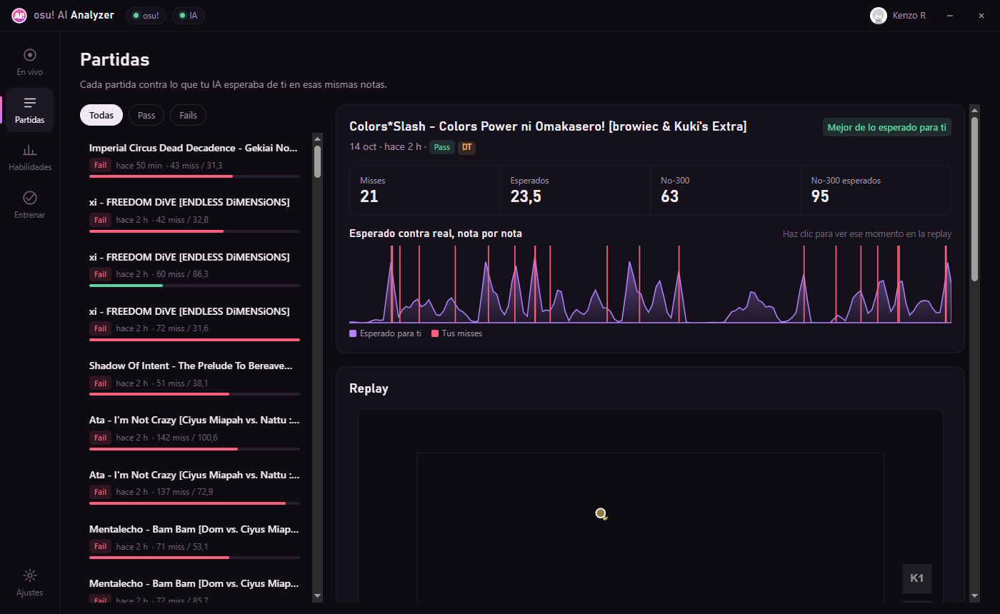
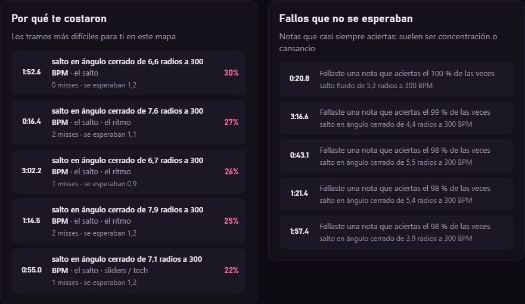
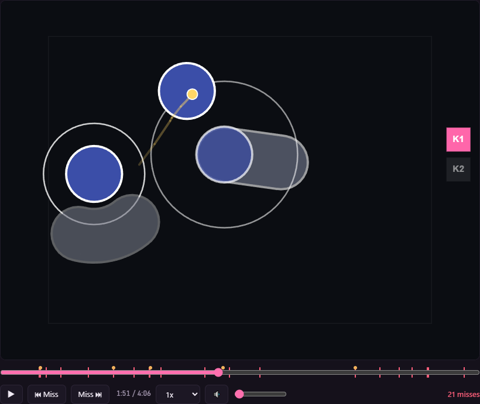
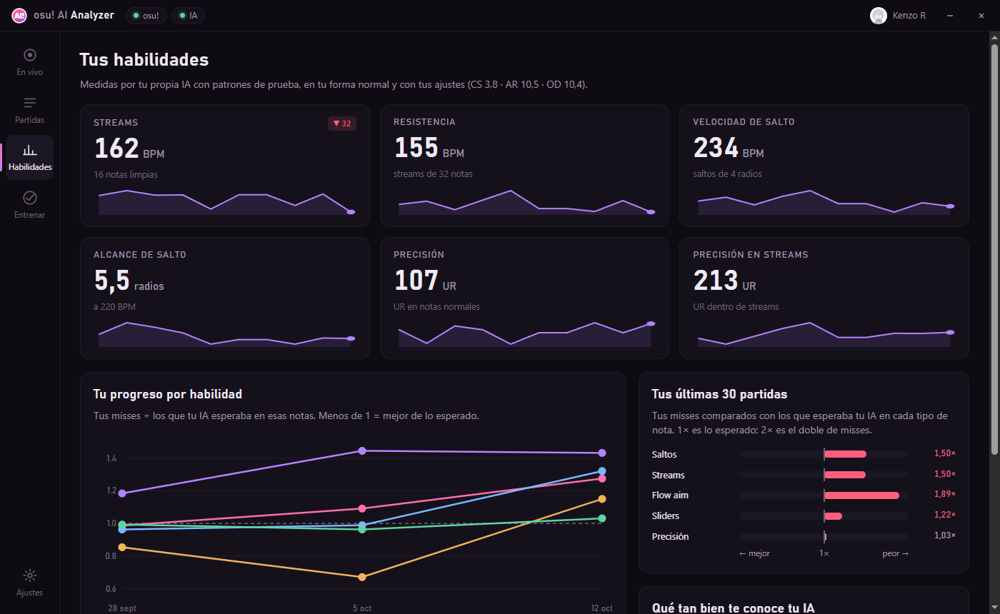
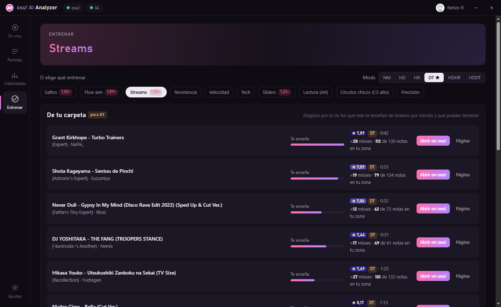

  

  
  
  
  

  <b>Español</b> · <a href="README.en.md">English</a>

---

**osu! AI Analyzer** es una aplicación para Windows que acompaña a osu! stable. Tiene una red neuronal que aprende **solo de tus propias partidas**, nota por nota, y la usa para tres cosas:

- **Antes de jugar un mapa:** cuántos misses espera de ti, en qué segundos y qué patrón te los va a causar.
- **Después de jugarlo:** dónde fallaste más o menos de lo esperado, y qué misses fueron por el mapa y cuáles por concentración o cansancio.
- **Para practicar:** qué habilidad te conviene entrenar y qué mapas de tu propia carpeta te enseñan más de esa habilidad.

  

## Contenido

- [Qué hace](#qué-hace)
- [Cómo funciona](#cómo-funciona)
- [Rendimiento](#rendimiento)
- [Privacidad y licencia](#privacidad-y-licencia)
- [Instalar](#instalar)
- [Preguntas frecuentes](#preguntas-frecuentes)

## Qué hace

### En vivo: tu IA antes de jugar

Al seleccionar un mapa en osu!, la pantalla **En vivo** muestra:

- **Misses esperados** para ti en ese mapa, comparados con los que sueles tener en los mapas que terminas. Te dice si el mapa te queda cómodo, en tu límite o muy por encima de tu nivel.
- **Dónde te va a costar:** una barra con los misses esperados en cada momento del mapa. Mientras juegas, marca tus misses reales y el punto en que vas.
- **Los 3 tramos más difíciles para ti**, cada uno con el patrón concreto que lo hace difícil, por ejemplo *"stream de 17 notas a 200 BPM"* o *"salto de 5,3 radios a 230 BPM"*.
- El **leaderboard** global o de tu país, tu última partida y la habilidad que te toca entrenar hoy.

### Partidas: cada intento contra lo que se esperaba de ti

Cada partida queda guardada como **Pass** (terminaste el mapa) o **Fail** (moriste, saliste o reiniciaste). Para cada una:

- **Lo esperado contra lo real, nota por nota**, en un gráfico donde puedes hacer clic para ir a ese momento de la replay.
- **La replay dentro de la app**, con el cursor, las teclas, el audio del mapa y los misses marcados. También para los fails, aunque osu! no guarde replay de ellos (ver [cómo funciona](#cómo-funciona)).
- **Por qué te costaron:** los 5 tramos más difíciles para ti, con su patrón, los misses que tuviste y los que se esperaban.
- **Fallos que no se esperaban:** misses en notas que casi siempre aciertas. Suelen ser concentración o cansancio, no falta de habilidad. Si van seguidos, se agrupan.
- **Dónde caen tus clics** en los saltos (si te quedas corto o te pasas) y tu error de timing.

  

  
  

### Habilidades: medidas por tu propia IA

Tu IA juega patrones de prueba (streams de 16 notas, streams de 32, saltos de 4 radios a distintos BPM, saltos cada vez más largos a 220 BPM) con tu configuración habitual (CS, AR, OD) y encuentra dónde está tu límite. Así obtienes:

| Habilidad | Qué mide |
|---|---|
| Streams | BPM al que limpias 16 notas seguidas |
| Resistencia | BPM al que aguantas streams de 32 notas |
| Velocidad de salto | BPM al que aciertas saltos de 4 radios |
| Alcance de salto | distancia máxima de salto que aciertas a 220 BPM |
| Precisión | tu UR en notas normales |
| Precisión en streams | tu UR dentro de streams |

También ves tu progreso por habilidad en el tiempo y, en tus últimas 30 partidas, cuántos misses tuviste en cada tipo de nota comparado con lo que tu IA esperaba (1× es lo esperado; 2× es el doble).

  

### Entrenar: qué practicar y con qué mapas

La app propone la habilidad que más te está costando, o eliges tú entre diez: saltos, flow aim, streams, resistencia, velocidad, tech, sliders, lectura (AR), círculos chicos (CS alto) y precisión. Para esa habilidad te da:

- **Mapas de tu carpeta**, 10 por página, para los mods que elijas (NM, HD, HR, DT, HDHR, HDDT). Un mapa solo aparece en un skillset si ese patrón es el que domina el mapa: en *Streams* hay mapas de streams, no mapas de saltos con algunos streams. Se ordenan por cuánto te enseñan de esa habilidad por minuto, y solo entran mapas que puedes terminar. Un clic lo abre en osu!.
- **Un mapa hecho para ti** (archivo `.osz`), con el patrón de esa habilidad que más te cuesta y la dificultad subiendo en 6 tramos hasta tu límite.
- **¿Está funcionando?:** compara tus partidas de antes y después de empezar a practicar una habilidad, siempre contra lo esperado para ti.

  

### Overlays para stream

La app agrega sus propios overlays al panel de tosu, cada uno con su enlace para usarlo como *Fuente de navegador* en OBS: mapa y tiempo, PP, teclas, 100/50/miss, combo y precisión, barra de hit error con UR, lo que tu IA espera en el mapa, y uno completo con todo.

  
  

### Además

- **13 idiomas:** español, inglés, portugués, francés, alemán, ruso, polaco, turco, indonesio, japonés, coreano y chino (simplificado y tradicional). La app arranca en el idioma de Windows y se puede cambiar desde la primera ventana.
- **Actualizaciones automáticas:** cuando sale una versión nueva, la app la ofrece y se instala sola. Cada actualización va firmada y la app rechaza cualquier archivo que no lo esté.

## Cómo funciona

### 1. Lee el juego, sin modificarlo

La app no toca osu!. Lee lo que pasa en el juego con [tosu](https://github.com/tosuapp/tosu), el mismo lector que usan los overlays de stream: el mapa seleccionado, los mods, la vida, los aciertos y las teclas. Las partidas terminadas salen de las replays que osu! ya guarda en tu carpeta (`Data/r`).

### 2. Juzga cada nota

Con el mapa (`.osu`) y la replay, la app vuelve a juzgar la partida nota por nota, como lo hace osu!: 300, 100, 50 o miss, tu error de timing en milisegundos y dónde cayó tu clic respecto del centro de la nota.

osu! no guarda replay de un fail ni de un mapa que dejas a medias. Para esos casos la app graba tu cursor y tus teclas mientras juegas, y al terminar reconstruye la partida y la juzga igual. Solo la guarda si coincide con lo que osu! contó; si no coincide, la descarta.

### 3. Describe cada nota con números

De cada nota se calculan 27 medidas a partir del mapa: distancia y ángulo del salto, velocidad, tiempo desde la nota anterior, BPM, si está en un stream y en qué posición, si es slider, AR, CS, OD, en qué parte del mapa va, cuántos minutos llevas jugando, y otras. A eso se suman 4 datos de cómo llegas a la partida: cuántas veces ya intentaste ese mapa, cuánto tiempo pasó desde tu partida anterior, cuántas llevas en la sesión y cómo te fue en las últimas 5.

### 4. La red neuronal

Cada nota se mira junto con las 12 anteriores y las 4 siguientes, porque un salto cuesta distinto si llega al final de un stream. Esa ventana de 17 notas entra a una red de dos capas (256 y 128 neuronas), que predice para cada nota:

- la probabilidad de miss,
- la probabilidad de no sacar 300,
- tu error de timing esperado y cuánto varía,
- hacia dónde se desvía tu clic, a lo largo del salto y hacia los lados.

Hay 3 redes entrenadas por separado y la app usa el promedio de las tres, que es más estable que una sola.

### 5. Se entrena en tu PC, solo con tus partidas

- La primera vez lee todas tus replays guardadas y entrena. Con unas 200 partidas tarda alrededor de un minuto.
- Después se vuelve a entrenar sola cuando tienes un 10 % más de partidas que la última vez.
- Antes de usarse, se pone a prueba con tus partidas más recientes, que no ve al entrenar. Si no predice mejor que tus promedios, la app no la usa.
- Toda esa información se queda en tu PC.

### 6. Lo que se calcula con la red

- **Pronóstico de un mapa:** la red predice cada nota del mapa antes de que lo juegues. La suma son tus misses esperados, y las zonas donde se juntan son los tramos difíciles.
- **Tu partida contra lo esperado:** se compara con lo que esperaba una IA que todavía no había visto esa partida, para que la comparación sea justa.
- **Mapas para practicar:** la red puntúa todos los mapas de tu carpeta cerca de tu nivel (miles, para cada combinación de mods). Para cada habilidad mide cuánta información nueva te da el mapa por minuto: las notas que te enseñan más son las que tienes una probabilidad intermedia de fallar. Después se queda con los mapas donde esa habilidad es el patrón principal y que puedes terminar.
- **Habilidades:** la red juega patrones de prueba a distintas velocidades y distancias hasta encontrar tu límite.

## Rendimiento

La app está pensada para no quitarle rendimiento a osu!:

- **Mientras juegas un mapa**, todo el trabajo de fondo (leer replays, entrenar, puntuar la carpeta) se pausa y sigue cuando vuelves a los menús.
- El servicio de IA corre con **prioridad baja** y usa **como máximo 2 núcleos**.
- **En reposo**, la app usa entre 2 y 6 % de CPU.

Medido en la versión 2.0.1:

| | Tiempo |
|---|---|
| Cambiar de pantalla | menos de 0,1 s |
| Abrir una partida con su replay | 0,1 a 0,5 s |
| Cambiar de skillset o de página en Entrenar | menos de 0,1 s |
| Primera puesta en marcha (200 replays: leer, entrenar y puntuar la carpeta) | unos 2 minutos |

Simulando un PC de gama baja (interfaz 4 veces más lenta y el servicio de IA en 1 núcleo), ninguna acción tardó más de 1 segundo.

## Privacidad y licencia

- **Tus replays, tus partidas y tu IA se quedan en tu PC.** Nada de eso se sube a ningún lado.
- La app solo se conecta a internet para: pedir a la API de osu! los leaderboards y los datos de los mapas, comprobar tu licencia, y buscar actualizaciones.
- **La licencia está ligada a tu cuenta de osu!.** Al abrir la app aparece primero solo la ventana de activación. La app completa se abre recién cuando la licencia es válida, el servidor la confirma y osu! está abierto con esa misma cuenta.
- Las licencias van firmadas digitalmente: no se pueden inventar ni modificar, y se pueden desactivar desde el servidor.
- El código fuente de la aplicación no es público.

  

## Instalar

> **Beta cerrada:** la app necesita una licencia ligada a tu cuenta de osu!. Si quieres probarla, escríbele a **[Kenzo R en osu!](https://osu.ppy.sh/users/10338561)**.

1. Descarga **`osu-AI-Analyzer-Setup-x.y.z.exe`** desde [**Releases**](https://github.com/justafailure1/osu-ai-analyzer/releases/latest).
2. Ábrelo. Windows puede mostrar *"Windows protegió su PC"* porque el instalador no está firmado con un certificado comercial: haz clic en **Más información** y luego en **Ejecutar de todas formas**.
3. En la ventana de activación, elige tu idioma y pega tu licencia.
4. Abre osu! con la cuenta de la licencia. La app se abre sola; la primera vez lee tus replays y entrena tu IA (unos 2 minutos).

**Requisitos:** Windows 10 u 11 (64 bits), osu! stable y 1 GB de espacio libre.

## Preguntas frecuentes

<b>¿Funciona con osu!lazer?</b>

Está pensada para osu! stable. El soporte de osu!lazer está en pruebas.

<b>¿Cuánto tarda la IA en conocerme?</b>

Las replays que ya tienes en osu! cuentan desde el primer día. Necesita al menos 20 partidas; con unas 200 tarda un par de minutos en entrenarse. Después se reentrena sola cada vez que tienes un 10 % más de partidas.

<b>¿Por qué un retry o salir del mapa aparece como Fail?</b>

Para la app, un intento que no llegó al final del mapa es un Fail, ya sea porque se acabó la vida, porque saliste o porque reiniciaste. Igual cuenta como dato para tu IA y puedes ver su replay.

<b>¿Por qué en un skillset aparecen pocos mapas?</b>

Un mapa solo aparece si de verdad es de ese skillset y lo puedes terminar. Si tu carpeta tiene pocos mapas así cerca de tu nivel (pasa a veces con resistencia o precisión), la app muestra los que hay en vez de rellenar con mapas de otro tipo. Probar otros mods suele dar más opciones.

<b>¿Por qué no aparece el leaderboard de mi país?</b>

osu! solo entrega leaderboards por país a cuentas con osu!supporter.

<b>¿Pierdo mis datos si reinstalo o actualizo?</b>

No. Desinstalar o actualizar conserva tus partidas, tu IA, tu idioma y tu licencia.

---

   
  osu! AI Analyzer no está afiliado a osu! ni a ppy Pty Ltd. · Software propietario, todos los derechos reservados. 
  Usa componentes de terceros bajo sus propias licencias (incluye tosu y lazer-calculator, LGPL-3.0); el detalle va en la carpeta <code>licencias</code> de la instalación.

